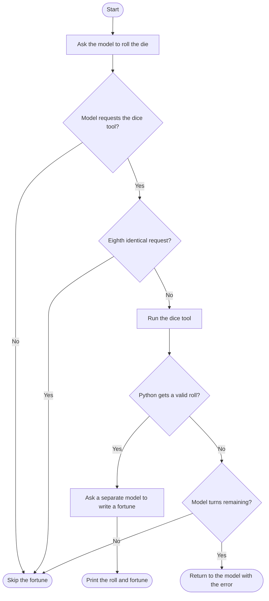

# Simple loop 1 — dice and fortunes

[Back to the playground](../README.md)

This example has two stages. First, a model requests a six-sided dice tool. The
tool fails about one-third of the time, and errors are fed back to the model so
it can retry. Python accepts a numeric result and stops the loop. Second, a
separate model call returns structured JSON with `meaning` and `fortune` fields.
Python prints them under **What Your {roll} Means** and **Your Fortune**.

The loop allows up to 10 model turns, adds a warning on the fifth identical tool
request, and aborts before executing the eighth identical request. A response
without a tool request also ends the loop. If there is no valid roll, fortune
generation is skipped.

## Setup and run

Run these PowerShell commands from the repository root.

```powershell
python -m venv simple-loop-1/.venv
.\simple-loop-1\.venv\Scripts\python.exe -m pip install -r simple-loop-1/requirements-dev.txt
```

Set `ANTHROPIC_API_KEY` in your environment or create `simple-loop-1/.env` with
`ANTHROPIC_API_KEY=your-key`. The example's Git ignore rules exclude that file.
Model names are configured in [agent.py](agent.py).

```powershell
.\simple-loop-1\.venv\Scripts\python.exe simple-loop-1/agent.py
```

## API timeouts

Both model stages use the SDK timeout setting of 30 seconds, configured with
`API_TIMEOUT_SECONDS` in `agent.py`. SDK retries are disabled. A timeout ends
the command with an explanatory message and a nonzero exit status. Run the
command again to retry. Dice-tool failures still follow the agent retry loop.

The SDK timeout governs network operations; it is not a deadline for the whole
multi-call agent run. Evaluations use the same setting for generation and judging
and record timeout failures before continuing to the next case.

## Flow

The retry endpoint returns to the model with the error. It is drawn as an endpoint
to keep the diagram flowing from top to bottom.



## Tests

Run from the repository root. Tests mock API calls and require no API credentials.

```powershell
.\simple-loop-1\.venv\Scripts\python.exe -m pytest simple-loop-1/tests -q
```

## Live evaluations

Run from the repository root with `ANTHROPIC_API_KEY` configured in the environment
or `simple-loop-1/.env`. Evaluations make paid API calls for generation and judging.

```powershell
.\simple-loop-1\.venv\Scripts\python.exe simple-loop-1/evals/run_evals.py
```

Add `--repeats 5` for repeated sampling. Each repeat evaluates four dice scenarios
and generates a fortune for each of the six die faces.

The dice scenarios temporarily replace the tool implementation with predictable
outcomes, including failures followed by success. The real model decides whether
to request the tool and retry. Checks cover tool selection, expected results,
execution counts for successful scenarios, and the turn limit.

Fortune evaluations check the required fields and combined word limit. Each
fortune with valid fields also goes to a separate model call that grades its
quality and explains each score.

| Dimension | Score 1 | Score 3 | Score 5 |
| --- | --- | --- | --- |
| Number relevance | Unrelated to the roll | Plausible connection | Clearly and creatively tied to the number |
| Playfulness | Flat or unpleasant | Pleasant | Imaginative and fun |
| Clarity | Confusing | Understandable | Concise and easy to read |

The judge defaults to the fortune model. Add `--judge-model MODEL_ID` to use
another available model. Scores are subjective model judgments; inspect the
saved explanations to see whether they match your expectations.

The final console summary reports average quality scores, the number of fortunes
judged, and total input and output tokens. Judge tokens appear separately and are
included in the overall total. Usage covers API responses that return token counts.

Quality scores have no pass threshold. PASS means the deterministic checks passed
and any required judging completed successfully. A judging error fails the case
and preserves its generated output and checks. Failed or skipped judgments are
excluded from quality averages.

JSON reports are saved under `simple-loop-1/evals/results/` after each case. They
include requests, responses, model names, checks, ratings, explanations, timing,
and token totals. Use `--output path/to/report.json` to choose a report location.

See [the evaluation guide](evals/README.md) for additional details.

## Human ratings and judging cost

The runner automatically supplies the rubric, die roll, and generated fortune to
a separate judging call. Human ratings are optional. To assess the judge, score
a small set of fortunes yourself and compare the judge's ratings on those same
outputs. A few examples could later be added to its prompt to clarify your
standards. The current runner uses the rubric and current output only.

Each valid fortune adds a judging call. Compare its token usage with generation
usage, keep repeat counts modest while experimenting, and run live evaluations
when changing prompts or models. The mocked unit tests can run frequently.

See the root README for [ideas to go further](../README.md#ideas-to-go-further).
