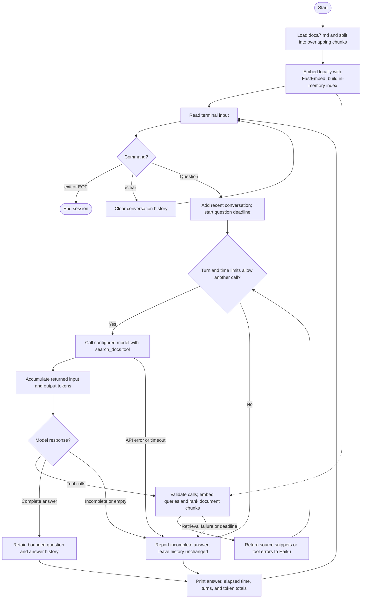

# Simple RAG agent

This terminal assistant answers questions about the entirely fictional
**Northstar Ferry Cooperative**. Ten Markdown documents describe its policies,
schedules, and edge cases. Haiku chooses when to call `search_docs`.
It can search repeatedly. It answers with source citations.
Nothing here books real travel.

## Flow



The app caches model weights on disk. It keeps the document index in memory.
It also keeps the conversation in memory.
The question deadline covers the model/search loop, not startup indexing.

## Setup (Python 3.11+)

From the repository root on Linux/macOS:

```bash
python3 -m venv simple-rag-agent/.venv
simple-rag-agent/.venv/bin/python -m pip install -r simple-rag-agent/requirements-dev.txt
cp simple-rag-agent/.env.example simple-rag-agent/.env
# Set ANTHROPIC_API_KEY securely in .env or your process environment.
simple-rag-agent/.venv/bin/python simple-rag-agent/agent.py
```

On Windows use `.venv\Scripts\python.exe` instead of `.venv/bin/python`.
Set `RAG_MODEL` to override `claude-haiku-5-5`. Live chat makes paid Anthropic
API calls and needs HTTPS access to `api.anthropic.com` and an account with model
access. No Ollama, Chroma server, LangChain, or embedding API key is required.
At startup, the app prints the model ID it uses for requests. An unset or
blank `RAG_MODEL` uses the default.

## Semantic retrieval

FastEmbed runs `BAAI/bge-small-en-v1.5` locally on the CPU through ONNX Runtime.
The first index build downloads model artifacts from Hugging Face and may need
access to its download/CDN hosts. The app caches model weights in the ignored
`.cache/` folder. Later runs can reuse them.
The model cache is **not conversation memory**.

The app reads Markdown files from this project's `docs/`.
It splits the files into 220-word chunks with 40-word overlap.
FastEmbed converts passages and queries to embeddings.
Normalized dot products rank passages by semantic similarity.
Only the top three chunks are returned by
default, with a maximum of five per call. Scores are not calibrated confidence
values, and an irrelevant question still has a nearest match. The agent is
instructed to admit insufficient evidence. Citations are model-generated, not
automatically verified, so inspect sources for consequential decisions.

The app rebuilds the document index **in memory at startup**. Edits to docs take effect
after restarting. The last four completed question/answer pairs provide follow-up
context; search traces are not carried into the next question. Type `/clear` to
forget that context, or `exit` to stop. Exiting loses the entire conversation and
index. No chat logs, vectors, or usage records are saved. Retrieved excerpts and
recent conversation text are sent to Anthropic; embeddings stay local.

## Agent loop and limits

Haiku receives the tool definition with each question.
It decides whether to search, refine a search, or answer.
The app returns tool results to Haiku as structured JSON.
Each search result includes filename/chunk references.
The app returns tool errors for invalid calls.
The model can then correct those calls.
Retrieved documents are treated as reference data, not commands.

Defaults: six model turns, 900 output tokens per response, 25 seconds per API call,
and a 90-second overall question deadline. SDK automatic retries are disabled.
The question deadline includes retrieval; initial model download and indexing
happen before chat and are outside that deadline. Local search runs in a worker
thread; cancellation stops waiting but does not forcibly kill native embedding
work already running. EOF/Ctrl-C exits. API failures, truncation, and limits are
reported as incomplete answers and are not added to conversation history.

After each answer, the app prints elapsed time and model turns.
It also prints input/output tokens for the question and session.
These are actual usage fields from completed API responses,
including tool-loop turns and resent conversation context. If a timed-out or
failed request incurred server usage without returning it, that usage is unknown
and absent from totals. Local embedding work consumes no Anthropic tokens. Counts
are not a price estimate. `/clear` leaves session token totals intact.

## Tests and a semantic smoke check

```bash
simple-rag-agent/.venv/bin/python -m pytest simple-rag-agent/tests -q
simple-rag-agent/.venv/bin/python -m pip check
```

Tests use mocked APIs and embeddings: no key, network, downloads, or paid calls.
Run the command below from the project folder to check real local embeddings.
It downloads/caches model weights. It does not use Claude.

```bash
.venv/bin/python smoke_search.py
```

This checks semantic paraphrases against expected document sources. It is separate
from unit tests because it requires the embedding model artifacts.

Try these questions in chat:

- Can I get my money back if strong winds stop my connecting trip?
- Can a wheelchair traveler reach Mossbank when the gauge reads 1.0 meters?
- What does a member adult pay to reach Mossbank, bringing a bicycle?
- Can someone from Mossbank get home after the late festival sailing?
- How long do you keep assistance notes compared with payment records?
- Do you serve an airport? Can you confirm a seat for tomorrow?
